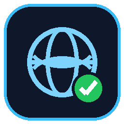
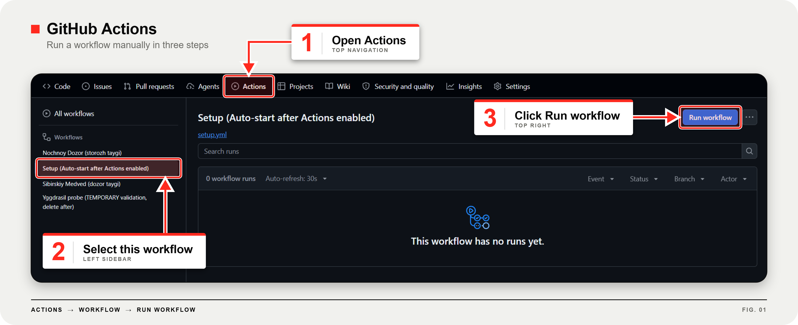

<div align="center">



<h1>IPNET</h1>

<h3>🇺🇸 USA Proxy in One Click</h3>

<p>Your own free private US server — Windows app + Android subscription.<br>
No admin rights. No paid servers. Self-healing.</p>

<a href="https://youtu.be/PMoJyTe8h4w"></a>
<a href="https://www.youtube.com/@Kareem-X5Coder"></a>

<br><br>

<table>
<tr>
<td align="center" width="260"><b>① Create your server</b><br><sub>one-time, 2 minutes</sub><br><br><a href="#step1">Go ↓</a></td>
<td align="center" width="260"><b>② Connect on Windows</b><br><sub>click Start</sub><br><br><a href="#windows">Go ↓</a></td>
<td align="center" width="260"><b>③ Connect on Android</b><br><sub>one subscription link</sub><br><br><a href="#android">Go ↓</a></td>
</tr>
</table>

</div>

<br>

<h2 id="step1" align="center">① Create your server <sub>(one time only)</sub></h2>

<div align="center">

<table>
<tr>
<td align="center"><b>1</b></td>
<td>Open <a href="https://github.com/X5Coder/IPNET"><code>X5Coder/IPNET</code></a> → click <b>Use this template</b> → <b>Create a new repository</b>.<br>
⚠️ Make it <b>Public</b>.</td>
</tr>
<tr>
<td align="center"><b>2</b></td>
<td>In your new repo, open the <b>Actions</b> tab.</td>
</tr>
<tr>
<td align="center"><b>3</b></td>
<td>Start the <b>Setup (Auto-start after Actions enabled)</b> workflow, exactly like in the picture below 👇</td>
</tr>
</table>

<br>



<br>

<sub>✅ Done. Your server now runs by itself. If it ever stops, it restarts automatically within 30 minutes.</sub>

</div>

<br>

<h2 id="windows" align="center">② Connect on Windows 💻</h2>

<div align="center">

<table>
<tr>
<td align="center"><b>1</b></td>
<td>Download <a href="https://github.com/X5Coder/IPNET/releases/latest/download/IPNET.exe"><b>IPNET.exe</b></a> and run it.</td>
</tr>
<tr>
<td align="center"><b>2</b></td>
<td>Paste <b>your repo link</b> → click <b>Start</b>. Chrome opens with a US IP.</td>
</tr>
<tr>
<td align="center"><b>3</b></td>
<td>Next time, your link is saved — just click <b>Start</b>.</td>
</tr>
</table>

</div>

<br>

<h2 id="android" align="center">③ Connect on Android 📱</h2>

<div align="center">

<table>
<tr>
<td align="center"><b>1</b></td>
<td>Install <a href="https://github.com/2dust/v2rayNG/releases/download/2.2.6/v2rayNG_2.2.6_arm64-v8a.apk"><b>v2rayNG</b></a>.</td>
</tr>
<tr>
<td align="center"><b>2</b></td>
<td>Top-left menu → <b>Subscription group setting</b> → tap <b>+</b>.</td>
</tr>
<tr>
<td align="center"><b>3</b></td>
<td>Fill in the fields below, then tap <b>✓</b>.</td>
</tr>
</table>

<br>

<table>
<tr><th>Field</th><th>Value</th></tr>
<tr><td><code>remarks</code></td><td><code>IPNET</code></td></tr>
<tr><td><code>Optional URL</code></td><td><code>https://raw.githubusercontent.com/YOU/YOUR-REPO/main/zayachiy_sled.txt</code><br><sub>replace <code>YOU/YOUR-REPO</code> with your own repo</sub></td></tr>
<tr><td><code>Enable update</code></td><td>✅ ON</td></tr>
<tr><td><code>Enable automatic update</code></td><td>✅ ON — interval <code>60</code></td></tr>
</table>

<br>

<table>
<tr>
<td align="center"><b>4</b></td>
<td>Main screen → <b>⋮</b> → <b>Update subscription</b> → tap <code>VOLK-TAYGA</code> → tap <b>▶</b> and allow VPN.</td>
</tr>
</table>

</div>

<br>

<h2 align="center">✅ Check it works</h2>

<div align="center">

Open <a href="https://ipleak.net/"><b>ipleak.net</b></a> — it should show <b>United States 🇺🇸</b>.

<br><br>

<details>
<summary><b>🔧 Stopped working?</b></summary>

<br>

The server changes its address every few hours. The subscription follows it automatically.<br><br>
<b>Android:</b> <b>⋮</b> → <b>Update subscription</b> → reconnect.<br>
<b>Windows:</b> close the app and click <b>Start</b> again.<br>
<b>Still dead?</b> Open the <b>Actions</b> tab in your repo and make sure the workflow is running (see the picture in step ①).

</details>

</div>

<br>

<div align="center">

<h3>⭐ Like IPNET?</h3>

<a href="https://github.com/X5Coder/IPNET"></a>

<br><br>

<sub>Original project: <a href="https://github.com/X5Coder/IPNET">X5Coder/IPNET</a> · by X5Coder · Tutorials: <a href="https://www.youtube.com/@Kareem-X5Coder">YouTube</a></sub>

</div>

<!--VOLK-ZHIVO-START-->
## Live connection (auto-updated, copy from here)

- Repo: https://github.com/X5Coder/IPNET

- v2rayNG link (copy/QR, TLS+WebSocket via Cloudflare):
```
vmess://eyJ2IjoiMiIsInBzIjoiVk9MSy1UQVlHQSIsImFkZCI6InR3aW5zLW11c2ljYWwtaW50cm9kdWNlcy1kb29ycy50cnljbG91ZGZsYXJlLmNvbSIsInBvcnQiOiI0NDMiLCJpZCI6IjllYzhmM2JlLTc1OGUtNDg3Zi1iMDU3LWNiMWUxZGRmNGE5YiIsImFpZCI6IjAiLCJuZXQiOiJ3cyIsInR5cGUiOiJub25lIiwiaG9zdCI6InR3aW5zLW11c2ljYWwtaW50cm9kdWNlcy1kb29ycy50cnljbG91ZGZsYXJlLmNvbSIsInBhdGgiOiIvdGFpZ2EiLCJ0bHMiOiJ0bHMifQ==
```

- Subscription (fixed forever, auto-updates):
```
https://raw.githubusercontent.com/X5Coder/IPNET/main/zayachiy_sled.txt
```
<!--VOLK-ZHIVO-END-->
